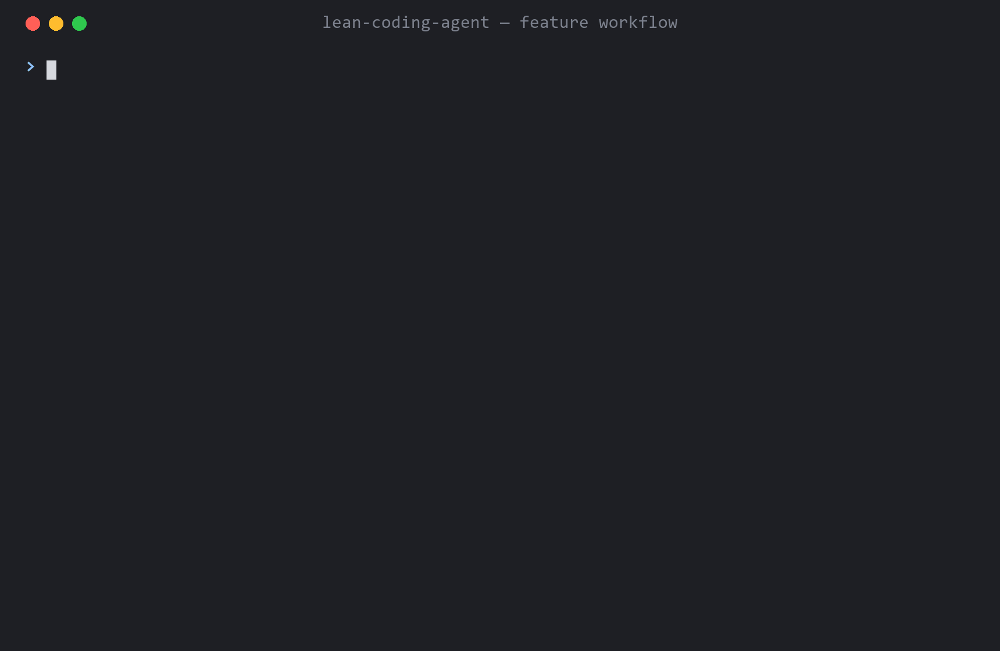

# Lean Coding Agent



[](https://github.com/aloilor/lean-coding-agent/actions/workflows/ci.yml)
[](https://github.com/aloilor/lean-coding-agent/releases)
[](LICENSE)
[](#quick-start)

Popular coding agent frameworks can be slow and token-hungry: huge ceremony fills the context on every request, and even a one-line fix goes through a full plan-and-review loop. In my experience, newer models don't need that much handholding and that many guardrails. Without a framework, agents tend to skip planning entirely. Lean Coding Agent gives Codex and Claude Code a **plan → test-first implementation → independent review** loop that runs only when you ask for it, with each step handled by a separate subagent in its own context. Predefined workflows set the loop and its stop conditions without scripting every move, each subagent prompt is at most 135 lines, and [`define-conventions`](skills/define-conventions/SKILL.md) captures your project's rules. Rules follow progressive disclosure: instead of piling everything into `AGENTS.md`, agents load each convention file by topic only when a task needs it. The always-loaded baseline stays under 800 words, and each workflow under 450.

- **Workflows.** The feature, bug-fix, and refactor workflows follow a simple loop: you approve a plan, then an implementer and a reviewer iterate until the reviewer approves. Implementation follows test-driven development, one behavior at a time. If the same problem survives three fix attempts, the loop stops and reports back. Planning and code review can also run on their own.
- **Subagents.** Each step runs in a subagent with its own context: planner, bug diagnostician, implementer, or code reviewer. An explorer looks up facts when needed. Each subagent is defined in a prompt file of at most 135 lines.
- **Project conventions.** The [`define-conventions`](skills/define-conventions/SKILL.md) skill scans your repository, asks about rules the code doesn't show, and writes them to `docs/conventions/` as separate files for coding standards, testing, change process, and deployment. Agents load only the files the current task needs, so a testing change reads `TESTING.md` and nothing about deployments. It's the main way to give the workflows your project's context.

Normal requests are handled directly. To use a workflow, start it by name.

I wanted short instructions, few additional tools to learn, and no mandatory workflow for small requests. For larger changes, I wanted a simple loop: plan, implement, review. I explain the design choices in [I built lean coding agent workflows because popular frameworks are bloated token sinks](https://aloilor.github.io/lean-coding-agent/).

## Why not just…?

- **…write a longer `CLAUDE.md` or `AGENTS.md`?** Every word in it is loaded for every request, including typo fixes. Here the always-loaded part stays small, project conventions load per topic only when a task needs them, and workflow instructions load only when you name a workflow.
- **…use a bigger skill or agent framework?** Many are bloated with handholding and guardrails that newer models no longer need, and all that instruction is a token sink on every request. Here the guidance lives where it matters: a precise plan you approve for each task, plus a short loop with clear stop conditions, instead of pages of generic rules. Nothing is mandatory: small requests run directly, and you choose when to pay for planning and review.
- **…let a single agent plan, build, and check its own work?** An agent reviewing its own context tends to approve itself. Here the reviewer is a separate subagent with fresh context, and the loop stops and reports back instead of retrying forever.
- **…use the strongest model for everything?** It costs more without improving well-specified execution. Strong models plan and review, and cheap models implement against an approved plan and tests. See [Model defaults](#model-defaults).

## Quick start

You need Node.js, npm, and a project opened in Codex or Claude Code.

1. Install the skills from your project directory:

   ```sh
   npx skills@latest add aloilor/lean-coding-agent
   ```

   In the installer, select Codex, Claude Code, or both, then select `setup-lean-coding-agent` and any other skills you want.

2. Commit or stash your work, ideally on a fresh branch, so `git diff` shows exactly what setup changes and `git checkout .` undoes it. If your project already has an `AGENTS.md` or `CLAUDE.md`, read [what setup changes](#what-setup-changes) first.

3. Run setup in your project: `/setup-lean-coding-agent` in Claude Code, or `$setup-lean-coding-agent` in Codex.

   Setup asks which coding agents to configure and which model each subagent should use, then offers to capture your project's conventions.

4. Work as usual. When you want the full loop, start a workflow by name with your request, for example in Claude Code:

   ```text
   /workflow-feature-development Add CSV export to the orders page
   ```

   In Codex, use `$workflow-feature-development` instead.

## What setup changes

Setup only writes inside your project, and every change shows up in `git status`. It doesn't touch your source code.

> [!IMPORTANT]
> Setup replaces `AGENTS.md` and `CLAUDE.md` on every run. If you already have content in them, move shared project rules to `docs/conventions/` and private notes to `AGENTS.override.md` first. Setup never overwrites those files.

<details>
<summary>Full list of changes</summary>

| Change | Details |
| --- | --- |
| Replaced on every run | `AGENTS.md` and `CLAUDE.md`. `AGENTS.md` is the active baseline, and `CLAUDE.md` points Claude Code to it. |
| Refreshed on every run | The five bundled subagents in `.codex/agents/` or `.claude/agents/`, the bundled skill overrides, the upstream skills below, and the three bundled templates in `.agents/templates/`. Your own agents, templates, and override index entries are preserved. |
| Created when missing | `AGENTS.override.md`, `.agents/lessons/`, `.agents/skill-overrides/`, and, for Codex, `.codex/config.toml` with multi-agent defaults and a status line, and, for Claude Code, a status line in `.claude/statusline.mjs` registered in `.claude/settings.json` unless that file already sets one, plus per-model `autoCompactWindow` limits for models without one and `permissions.deny` entries for the `Artifact` and `PowerShell` tools when they are not already denied. `Artifact` is denied because coding sessions do not need claude.ai artifacts and its tool and skill definitions consume context; `PowerShell` is denied so Claude Code on Windows runs every shell command through Bash (POSIX), keeping commands and scripts consistent across platforms. |
| Added to `.gitignore` | Local files and agent task and report directories. |
| Installed | The [upstream skills](#upstream-skills-installed-by-setup) from third-party repositories. |

</details>

`docs/conventions/` is written by [`define-conventions`](skills/define-conventions/SKILL.md), not by setup. Incident reports in `docs/incidents/` can be committed. Plans, implementation reports, and code reviews are git-ignored by default.

## Design choices

- **Short instructions.** Workflows coordinate five subagents: planner, diagnostician, implementer, reviewer, and explorer.
- **A shared baseline, adapted to each project.** The baseline combines shared engineering rules in [`AGENTS.md`](AGENTS.md) with predefined skills, workflows, and subagents. Separate files under `docs/conventions/` capture your project's coding standards, testing, deployment, and change process, loaded only when relevant. [`define-conventions`](skills/define-conventions/SKILL.md) scans your repository for evidence, then grills you on the rules it cannot show. [See why](docs/define-conventions-rationale.md).
- **Explicit workflow boundaries.** Bug repairs require an approved diagnosis, refactors stop if behavior would change, and reviews don't edit code. Workflows also stop if success would require weakening a test or expanding the approved scope.
- **Written task records.** Plans, implementation reports, reviews, and any requested incident reports preserve scope, decisions, and verification evidence across context compaction and sessions.
- **Models follow the work.** By default, setup spends on judgment and saves on execution: stronger models plan and review, and cheaper models diagnose, implement, and look things up. See [Model defaults](#model-defaults).
- **Separate skill overrides.** [Overrides](#skill-overrides) add project guidance without editing installed skills, allowing those skills to receive upstream updates.

## Skills

### Setup and project context

- [`setup-lean-coding-agent`](skills/setup-lean-coding-agent/SKILL.md) — install the baseline into the current project.
- [`define-conventions`](skills/define-conventions/SKILL.md) — create or update `docs/conventions/` by grilling you on the non-obvious rules your repository cannot show, including excellent code to imitate.
- [`lean-grill-with-docs`](skills/lean-grill-with-docs/SKILL.md) — clarify plans against project terminology and documented decisions. Forked and adapted from [Matt Pocock's original skill](https://github.com/mattpocock/skills).
- [`feature-specification`](skills/feature-specification/SKILL.md) — write a client-approvable feature spec from a fixed template.

### Change workflows

Workflows are user-invoked only: name one in your request to start it. The Claude Code skills set `disable-model-invocation: true`, and the Codex skills set `policy.allow_implicit_invocation: false` in `agents/openai.yaml`.

| Workflow | Use it for | Process | Guide |
| --- | --- | --- | --- |
| [`workflow-planning`](skills/workflow-planning/SKILL.md) | Planning work without implementing it. | Resolve scope, decisions, acceptance criteria, and verification expectations, then approve the plan. | [Planning](docs/workflows/planning.md) |
| [`workflow-feature-development`](skills/workflow-feature-development/SKILL.md) | Changing externally observable behavior. | Approve a plan, implement test-first, then review and verify. | [Feature development](docs/workflows/feature-development.md) |
| [`workflow-bug-fixing`](skills/workflow-bug-fixing/SKILL.md) | Investigating and repairing a bug or regression. | Diagnose, approve the repair plan, fix test-first, then review and verify. | [Bug fixing](docs/workflows/bug-fixing.md) |
| [`workflow-refactor`](skills/workflow-refactor/SKILL.md) | Restructuring code while preserving behavior. | Establish a baseline, approve a plan, make small changes, then review and verify. Stops if behavior would change. | [Refactoring](docs/workflows/refactor.md) |
| [`workflow-review`](skills/workflow-review/SKILL.md) | Reviewing code or assessing risk. | Record findings in severity order. Makes no fixes unless you ask. | [Code review](docs/workflows/review.md) |

The [workflow guides](docs/workflows/README.md) include process diagrams. The linked skills remain the canonical instructions.

Each workflow leaves a written record of the agreed scope, decisions, and verification evidence:

| Record | Path |
| --- | --- |
| Approved plan | `.agents/plans/plan_YYYYMMDD_<name>.md` |
| Implementation report | `.agents/implementation-reports/implementation_YYYYMMDD_<name>.md` |
| Review pass | `.agents/code-reviews/review_YYYYMMDD_<name>_pass_N.md` |
| Incident report, only on request | `docs/incidents/incident_YYYYMMDD_<name>.md` |

Setup installs shared [plan](skills/setup-lean-coding-agent/references/templates/plan.md), [implementation-report](skills/setup-lean-coding-agent/references/templates/implementation-report.md), and [code-review](skills/setup-lean-coding-agent/references/templates/code-review.md) templates, used by the planners, implementers, and reviewers of both coding agents.

### Engineering and Git

- [`git-conventional-commit`](skills/git-conventional-commit/SKILL.md) — create Conventional Commits when asked to commit, and push when asked.
- [`maintain-changelog`](skills/maintain-changelog/SKILL.md) — inspect Git history in any commit format and curate released or unreleased changes using Keep a Changelog and Semantic Versioning.

### Upstream skills installed by setup

| Skill | Source | Use when |
| --- | --- | --- |
| [`eli5`](https://www.skills.sh/anthropics/claude-plugins-community/eli5) | [anthropics/claude-plugins-community](https://github.com/anthropics/claude-plugins-community) | Explain a topic in beginner-friendly terms using a visual HTML artifact. |
| [`handoff`](https://github.com/mattpocock/skills/blob/main/skills/productivity/handoff/SKILL.md) | [mattpocock/skills](https://github.com/mattpocock/skills) | Pass ongoing work to another agent or session with a concise summary, next steps, and links to existing artifacts. |
| [`tdd`](https://github.com/mattpocock/skills/blob/main/skills/engineering/tdd/SKILL.md) | [mattpocock/skills](https://github.com/mattpocock/skills) | Build a feature or fix a bug test-first, one behavior slice at a time, using red-green-refactor. |
| [`refactor`](https://github.com/github/awesome-copilot/blob/main/skills/refactor/SKILL.md) | [github/awesome-copilot](https://github.com/github/awesome-copilot) | Improve code structure or readability while preserving externally visible behavior. |
| [`skill-creator`](https://github.com/anthropics/skills/tree/main/skills/skill-creator) | [anthropics/skills](https://github.com/anthropics/skills) | Create, improve, and evaluate agent skills with structured test cases and benchmarks. |

## Configuration

### Model defaults

The defaults spend on judgment and save on execution. You can choose a different model for each subagent during setup, or pass options such as `--planner-model` for Codex and `--claude-planner-model` for Claude Code.

| Subagent | Role | Codex | Claude Code |
| --- | --- | --- | --- |
| `planner` | Prepares plans. | `gpt-6.1-sol`, `low` | `opus`, `low` |
| `code-reviewer` | Independently reviews changes. | `gpt-6.1-sol`, `low` | `opus`, `low` |
| `bug-diagnostician` | Investigates bugs. | `gpt-6-luna`, `xhigh` | `haiku`, `xhigh` |
| `implementer` | Carries out approved plans. | `gpt-6-luna`, `xhigh` | `haiku`, `xhigh` |
| `explorer` | Looks up facts for `lean-grill-with-docs`. | `gpt-6-luna`, `high` | `haiku`, `high` |

Each entry shows the model and its reasoning effort.

**Why a cheap model implements.** By the time the implementer runs, the hard decisions are already made: you've approved a plan with acceptance criteria, the tests define what "done" means, and a stronger model reviews the result. What's left is mostly careful execution, which a cheap model at high effort handles at a fraction of the cost. When it gets stuck, the reviewer catches it, and the loop stops after three failed attempts rather than spending tokens in silence. If your codebase needs more judgment at implementation time, choose a stronger implementer during setup.

**Why low effort for the planner and reviewer.** Stronger models already reason well at low effort, and planning is interactive: you answer its questions, so faster turns matter more than long solo thinking.

### Skill overrides

Overrides add project guidance to an installed skill without changing the skill itself. Setup copies bundled overrides into `.agents/skill-overrides/` and maintains an `INDEX.md` there that maps skill names to their override files. Before using a skill, the agent checks this index and reads the matching `<skill-name>.md` file. If an override conflicts with the skill, the override takes precedence.

For example, the bundled [`tdd` override](skills/setup-lean-coding-agent/references/skill-overrides/tdd.md) applies the baseline's testing guidance whenever tests are planned, written, or reviewed. To add your own, create a matching Markdown file in `.agents/skill-overrides/` and link it from `INDEX.md`. Setup refreshes bundled override files while preserving your index entries.

To keep `lean-grill-with-docs` documentation somewhere other than the default `docs/conventions/GLOSSARY.md` and `docs/conventions/adr/`, choose a folder during setup (`--docs-dir docs/domain`). Setup generates the matching override for you.

## Updating

Update project-installed skills from the project directory:

```sh
npx skills update -p
```

Run `npx skills check` to see whether updates are available. To add skills introduced since your last selection, rerun `npx skills@latest add aloilor/lean-coding-agent` and select them. Rerun setup when you want refreshed project guidance, templates, overrides, or agent configuration. Remember that this replaces `AGENTS.md` and `CLAUDE.md`.

The Skills CLI owns skill installation, tracking, updates, and removal. See its [update documentation](https://github.com/vercel-labs/skills#skills-update) for scope options.

## Uninstalling

There's no uninstall command. To remove Lean Coding Agent from a project:

1. Run `npx skills remove` to remove the installed skills.
2. Delete the [files setup created](#what-setup-changes) and its `.gitignore` entries.

## Project status

Releases follow [Semantic Versioning](https://semver.org/), so breaking changes land only in major versions. See the [changelog](CHANGELOG.md).

The automated tests cover setup, not how agents behave once they're using the skills. The evaluation of `define-conventions` so far uses scripted answers instead of real interviews. Its [rationale](docs/define-conventions-rationale.md#limits-of-the-evidence) describes what hasn't been tested yet.

## Contributing

See [CONTRIBUTING.md](CONTRIBUTING.md).

## Acknowledgements

Lean Coding Agent builds on the work of others:

- [Matt Pocock's skills](https://github.com/mattpocock/skills) — the original grill-with-docs skill, forked and adapted as [`lean-grill-with-docs`](skills/lean-grill-with-docs/SKILL.md), plus the `handoff` and `tdd` skills installed by setup.
- [anthropics/skills](https://github.com/anthropics/skills) and [anthropics/claude-plugins-community](https://github.com/anthropics/claude-plugins-community) — the `skill-creator` and `eli5` skills.
- [github/awesome-copilot](https://github.com/github/awesome-copilot) — the `refactor` skill.
- [Vercel's Skills CLI](https://github.com/vercel-labs/skills) — installation, tracking, and updates.
- The research and writing cited in the [`define-conventions` rationale](docs/define-conventions-rationale.md), which shaped how conventions are captured.

## License

Available under the [MIT License](LICENSE).
