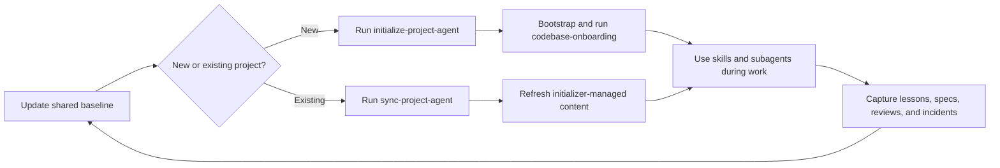
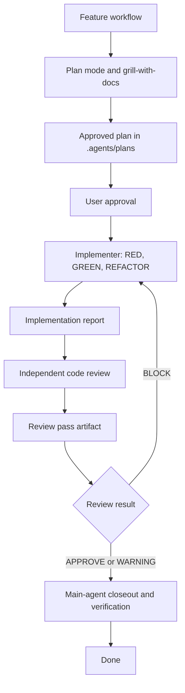
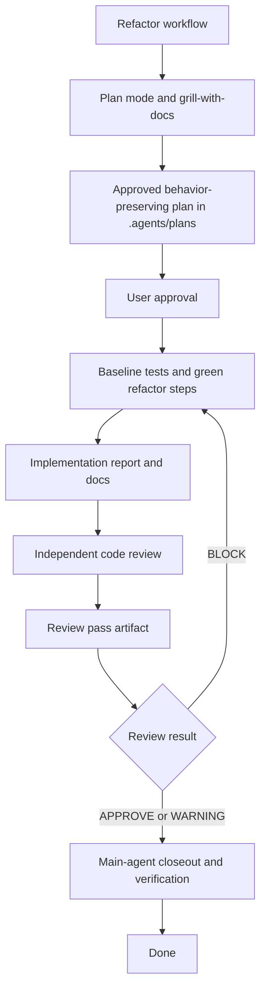
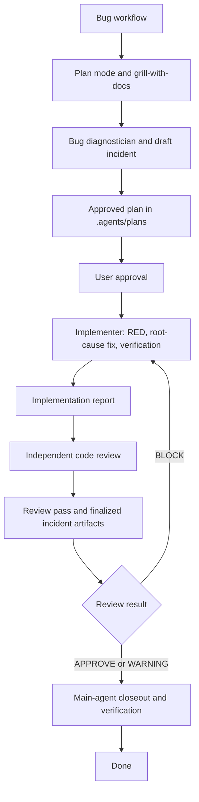

# coding-agent-baseline

This repository is the Codex-only shared base I want to reuse across all of my projects.

It contains the general agent guidance that should apply everywhere, regardless of stack, folder structure, or project type. The goal is to keep one central set of broad rules and standards that I can reference from each individual project.

The active Codex baseline lives in `AGENTS.md`. The initializer also retains `CLAUDE.md` and `CLAUDE.local.md` in each project for future compatibility, but it does not install or configure Claude Code.

Reusable coding, design, refactoring, debugging, and review guidance lives in the installable `engineering-standards` skill. Testing guidance lives in the installable `tdd` skill, supplemented by this repo's shared `tdd` override. REST API contract guidance lives in the installable `rest-api-design` skill. Requirements review against project documentation lives in the customized `grill-with-docs` skill. Structured project-context discovery lives in the customized `codebase-onboarding` skill. Each project should keep its shared project-specific context in `agent-context/`, such as:

- folder structure
- tech stack
- architecture conventions
- testing expectations
- project-specific workflows

Each project can also keep private local notes in:

- `AGENTS.local.md`
- `CLAUDE.local.md`

Those local files are ignored by git and are meant for local-only notes.

In other words:

- this repo defines the default baseline
- each project documents shared project-specific context in `agent-context/`
- this repo stores baseline skill overrides in `skills/skill-overrides/`
- each project receives installed-skill overrides in `.agents/skill-overrides/`
- each machine can keep private notes in the local files

This setup keeps the global guidance consistent while still allowing every project to document what makes it unique.

## Workflows

The baseline is organized around a few repeatable Codex workflows that keep context, planning, implementation, and review connected through durable artifacts in the project repo.

### Project Setup Cycle



### Feature Development Workflow

All `workflow-*` skills are strictly opt-in. Codex runs one only when the user explicitly names or calls it in the current request; task shape, size, risk, and complexity never trigger a workflow automatically. Requests that do not call a workflow use normal direct execution. **Once a planning workflow (`workflow-feature-development`, `workflow-refactor`, `workflow-bug-fixing`, or `workflow-feature-specification`) is explicitly invoked, running `$grill-with-docs` is mandatory: it must run in Plan mode before plan writing, approval, or implementation. A planning workflow must not proceed if the grill has not run. `workflow-review` is review-only and does not use this planning gate. Every workflow produces its applicable durable artifacts.**

The [workflow-feature-development](skills/workflow-feature-development) skill handles feature and change requests from small changes through complex externally observable behavior. Every run produces an approved plan, an implementation report, and one or more review-pass artifacts, with verification proportional to impact.



### Refactor Workflow

The [workflow-refactor](skills/workflow-refactor) skill handles behavior-preserving restructuring from local cleanup through complex refactors. Every run produces an approved plan, an implementation report, and one or more review-pass artifacts, with documentation and verification proportional to impact.

A refactor writes no new failing behavior test: it preserves behavior against the existing suite — adding characterization tests to pin any behavior to preserve that is not yet covered. The implementer records the passing-baseline exemption and characterization evidence when applicable.



### Bug Workflow

The [workflow-bug-fixing](skills/workflow-bug-fixing) skill handles bugs, failing tests, CI failures, runtime errors, and regressions from local repairs through consequential investigations. Every run produces an approved plan, a durable incident report, an implementation report, and one or more review-pass artifacts. Every bug is diagnosed and shown with its proposed repair and verification plan before implementation.



Workflow artifacts are written to consistent locations:

- `agent-context/` keeps shared project facts that should shape future work
- `.agents/plans/` keeps the single approved planning contract for feature, refactor, bug-fixing, and specification workflows
- `docs/incidents/` keeps bug investigations and final incident reports
- `.agents/implementation-reports/` and `.agents/code-reviews/` keep implementation handoffs and review passes for every applicable workflow
- `.agents/lessons/LESSONS.md` keeps reusable lessons learned from previous work

The [workflow-feature-specification](skills/workflow-feature-specification) workflow produces the approved plan as its durable specification artifact. The [workflow-review](skills/workflow-review) workflow produces a durable code-review pass without entering Plan mode.

## Skill Overrides

Installed skills (including marketplace skills) are overwritten when they update, so editing a skill directly to change its behavior for one project does not survive. This baseline keeps shared override sources in [skills/skill-overrides](skills/skill-overrides), and the bootstrap copies them into each target repo's `.agents/skill-overrides/` directory:

- one file per overridden skill, named `<skill-name>.md` to match the skill's name
- `skills/skill-overrides/INDEX.md` lists each baseline override with a one-line summary
- target repos consume those overrides from `.agents/skill-overrides/INDEX.md`

The baseline rule in `AGENTS.md` tells Codex to check `INDEX.md` before running a skill and, when the skill is listed, to read and apply the matching `<skill-name>.md` override as taking precedence over the skill's default behavior.

Overrides are for adjusting guidance the agent should follow (for example, where a skill saves its output or how strictly a workflow should run). They are shared with the team, unlike the private `AGENTS.local.md` / `CLAUDE.local.md` files.

## Initialize A New Project

Ask an agent in this repo to run `$initialize-project-agent` with the target project repo path. Do not run the bootstrap script directly for normal project setup; the skill wraps that script and then runs `$codebase-onboarding` in the target repo.

```text
Use $initialize-project-agent to initialize ../your-project-repo
```

The skill will:

- copy this repo's `AGENTS.md` into the target repo
- copy this repo's `CLAUDE.md` into the target repo
- create `AGENTS.local.md` and `CLAUDE.local.md` when they do not already exist
- add the local files to the target repo's `.gitignore`
- add project-local task note folders to the target repo's `.gitignore`
- copy Codex custom agent files into `.codex/agents/` from this repo's native TOML sources under `.codex/agents/`
- create `agent-context/` in the target repo
- copy missing baseline project-context starter files from this repo's `agent-context/`
- create `agent-context/README.md` when it does not already exist
- create `docs/incidents/README.md` when it does not already exist
- create `.agents/lessons/LESSONS.md` when it does not already exist
- copy baseline skill overrides from `skills/skill-overrides/` into `.agents/skill-overrides/`
- add `.agents/plans/`, `.agents/code-reviews/`, and `.agents/implementation-reports/` to the target repo's `.gitignore` for shared local workflow handoffs
- add `.agents/tasks/` and `.codex/tasks/` to the target repo's `.gitignore` for local task notes
- copy every installable skill from this repo's `skills/` folder into the target repo's `.agents/skills/`
- install or refresh upstream skills for Codex with `npx skills add`
- install `agent-browser` as a dev dependency and run `agent-browser install`
- write `agent-context/skills-installed.json` so the setup can be rerun cleanly
- write `skills-lock.json` for upstream skill installs
- run `$codebase-onboarding` in the target repo so `agent-context/` contains structured, evidence-backed project documentation, including `agent-context/skills.md`
- for a provisioned Laravel gate, have onboarding inventory all six checks, propose project-specific configuration for approval, activate approved tooling, run the gate, and record operational, failing, skipped, or approval-pending status

The initializer does not delete legacy Claude Code files or ignore entries from projects initialized by older baseline versions. Remove those artifacts manually if they are no longer wanted.

## Sync An Existing Project

After updating this baseline, ask an agent in this repo to run `$sync-project-agent` with an already initialized target project path:

```text
Use $sync-project-agent to refresh ../your-project-repo
```

The sync skill reruns the initializer's idempotent managed-file contract, checks for conflicting target edits, and verifies the refresh. It updates baseline-owned files, agents, skills, overrides, manifests, ignore rules, and tool installations while preserving project-owned context and private local files. It does not rerun `codebase-onboarding` unless the update requires project-context regeneration or you explicitly request it.

## Agent Browser Baseline

The bootstrap installs Agent Browser as a dev dependency using the package manager implied by `packageManager` or the existing lockfile. It then runs the package manager's local executable command for:

```bash
agent-browser install
```

The equivalent manual npm commands are:

```bash
npm install --save-dev agent-browser@latest
npx agent-browser install
```

The bootstrap also installs the upstream `agent-browser` skill so agents know how to use the local browser automation tool.

## Upstream Skills

The bootstrap installs or refreshes these upstream skills on every run:

| Skill | Source | Purpose |
| --- | --- | --- |
| `find-skills` | `vercel-labs/skills` | Search the skills ecosystem and install useful skills. |
| `agent-browser` | `vercel-labs/agent-browser` | Use persistent browser automation across agent commands. |
| `handoff` | `mattpocock/skills` | Create concise handoff documents for continuing work across sessions or agents. |
| `tdd` | `mattpocock/skills` | Guide behavior-focused test-driven development with red-green-refactor cycles. |
| `changelog-automation` | `wshobson/agents` | Generate or maintain changelog entries from project changes. |
| `create-readme` | `github/awesome-copilot` | Create a concise, useful project README. |
| `create-specification` | `github/awesome-copilot` | Create durable AI-ready specifications before implementation. |
| `prd` | `github/awesome-copilot` | Generate Product Requirements Documents from business vision and feature requirements. |
| `refactor` | `github/awesome-copilot` | Refactor code safely without changing behavior. |
| `sql-code-review` | `github/awesome-copilot` | Review SQL for correctness, security, maintainability, and performance. |
| `sql-optimization` | `github/awesome-copilot` | Optimize SQL queries, indexes, and execution patterns. |

The equivalent manual commands are:

```bash
npx skills add https://github.com/vercel-labs/skills --skill find-skills --agent codex --copy -y
npx skills add https://github.com/vercel-labs/agent-browser --skill agent-browser --agent codex --copy -y
npx skills add https://github.com/mattpocock/skills --skill handoff tdd --agent codex --copy -y
npx skills add https://github.com/wshobson/agents --skill changelog-automation --agent codex --copy -y
npx skills add https://github.com/github/awesome-copilot --skill create-readme create-specification prd refactor sql-code-review sql-optimization --agent codex --copy -y
```

`grill-with-docs` is installed from this repo's [skills/grill-with-docs](skills/grill-with-docs) instead of upstream so it can use `agent-context/` as the documentation source and treat `agent-context/domain.md` as the local replacement for upstream `CONTEXT.md`.

`codebase-onboarding` is installed from this repo's [skills/codebase-onboarding](skills/codebase-onboarding) instead of upstream so it fills `agent-context/` with structured, evidence-backed project documentation.

## Shared Subagents

Shared Codex subagent files live in [.codex/agents](.codex/agents) using Codex's native TOML schema. On every run, the bootstrap copies them directly into target projects under `.codex/agents/*.toml`. Customize the files in this baseline; target-repo copies are managed outputs.

The main agent owns feature, refactor, and bug-fixing planning in Plan mode. **It must run `grill-with-docs` before writing the plan.** It then consolidates the applicable requirements or diagnosis, boundaries, decisions, acceptance criteria, implementation or repair approach, and verification into one `.agents/plans/plan_YYYYMMDD_<name>.md`, and obtains explicit approval. That file is the sole planning source of truth for implementation and review.

Every bug-fixing workflow uses the Luna/extra-high [.codex/agents/bug-diagnostician.toml](.codex/agents/bug-diagnostician.toml) to investigate the assigned failure and draft `docs/incidents/incident_YYYYMMDD_short_description.md` from the canonical [incident template](docs/incidents/README.md). The main agent consolidates the diagnosis into the approved plan and presents the diagnosis, proposed repair, and verification plan for explicit approval before implementation.

Incident reports are durable project documents. Keep them under [docs/incidents](docs/incidents), not under `.agents/`, so they can be reviewed and retained with the project history.

The implementation subagent in [.codex/agents/implementer.toml](.codex/agents/implementer.toml) executes approved plans and bug investigations through the `tdd` red-green-refactor loop and relevant skills. Every feature, refactor, and bug-fixing workflow records its implementation handoff and verification in `.agents/implementation-reports/`. Review findings remain scoped inputs for the next repair pass.

The code review subagent in [.codex/agents/code-reviewer.toml](.codex/agents/code-reviewer.toml) runs on Luna/extra-high and reviews workflow changes against their applicable handoffs, including whether the code faithfully implements the originating issue, specification, approved plan, or feature plan. It applies the relevant engineering, testing, refactor, security, and database guidance before returning `APPROVE`, `WARNING`, or `BLOCK`, and records every pass in `.agents/code-reviews/`. It inspects surrounding callers and repository context when needed to understand the change's impact, but that inspection breadth does not expand repair scope: only change-caused findings and findings explicitly included by the approved request or handoff are actionable. Ripple findings in untouched code are surfaced without assignment until scope is approved, and unrelated pre-existing debt remains outside the implementation.

The Skills CLI writes the project lock file and installs Codex copies under `.agents/skills/<skill>`. The bootstrap does not mirror Codex skills into `.codex/skills`.
To change which skills get installed into future projects, add or remove skill folders in [skills](skills).

Repo-only skills for maintaining this shared repo are kept in [.agents/skills](.agents/skills) for Codex. Keep this local set intentionally small: [git-conventional-commit](.agents/skills/git-conventional-commit), [initialize-project-agent](.agents/skills/initialize-project-agent), and [sync-project-agent](.agents/skills/sync-project-agent). Do not place repo-only skills in `skills/`, because everything installable there is copied into new project repos.

## Sync Updated Shared Skills

When you want to propagate an updated shared skill from `skills/`, sync that change into any maintained copies in this repo and sibling project repos under `../`:

```bash
python scripts/sync_skills.py
```

To sync only one shared skill:

```bash
python scripts/sync_skills.py git-conventional-commit
```

The sync script only updates matching `.agents/skills/<skill>/` directories that already exist. It does not install missing shared skills into every sibling repo automatically.
