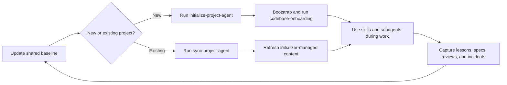
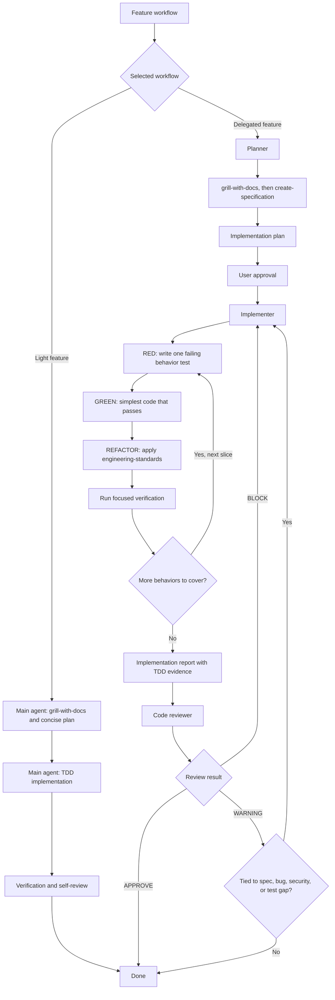
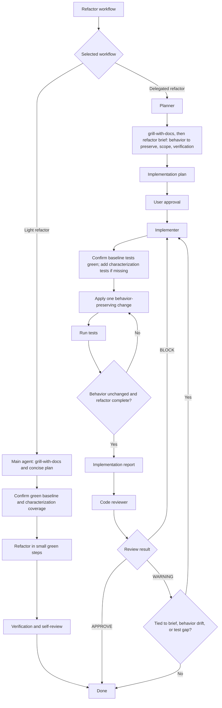
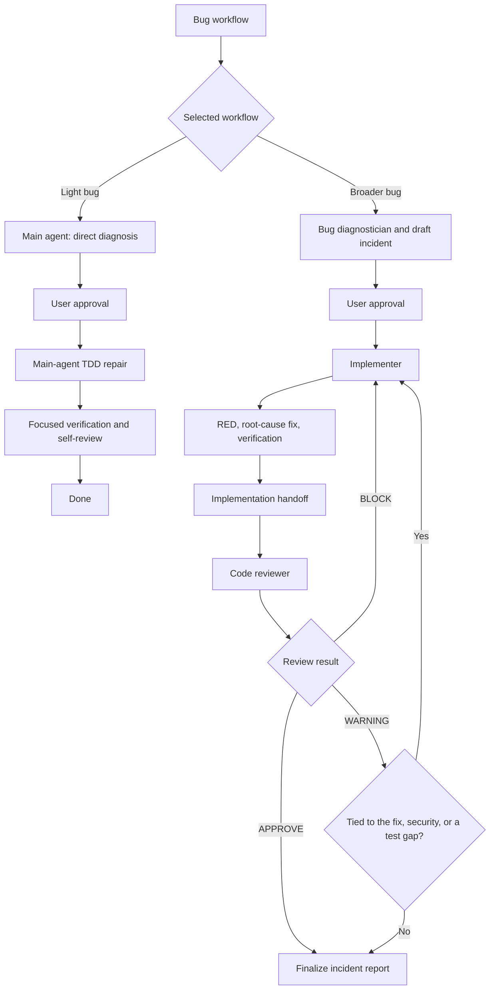

# coding-agent-baseline

This repository is the Codex-only shared base I want to reuse across all of my projects.

It contains the general agent guidance that should apply everywhere, regardless of stack, folder structure, or project type. The goal is to keep one central set of broad rules and standards that I can reference from each individual project.

The active Codex baseline lives in `AGENTS.md`. The initializer also retains `CLAUDE.md` and `CLAUDE.local.md` in each project for future compatibility, but it does not install or configure Claude Code.

Reusable coding, design, refactoring, debugging, and review guidance lives in the installable `engineering-standards` skill. Testing guidance lives in the installable `tdd` skill, extended by this repo's shared `tdd` override. REST API contract guidance lives in the installable `rest-api-design` skill. Requirements review against project documentation lives in the customized `grill-with-docs` skill. Structured project-context discovery and approved Laravel quality-gate activation live in the customized `codebase-onboarding` skill. Each project should keep its shared project-specific context in `agent-context/`, such as:

- folder structure
- tech stack
- architecture conventions
- testing expectations
- project-specific workflows

Each project can also keep private local notes in:

- `AGENTS.local.md`
- `CLAUDE.local.md`

Those local files are ignored by git and are meant for local-only notes.

In other words:

- this repo defines the default baseline
- each project documents shared project-specific context in `agent-context/`
- this repo stores baseline skill overrides in `skills/skill-overrides/`
- each project receives installed-skill overrides in `.agents/skill-overrides/`
- each machine can keep private notes in the local files

This setup keeps the global guidance consistent while still allowing every project to document what makes it unique.

## Workflows

The baseline is organized around a few repeatable Codex workflows that keep context, planning, implementation, and review connected through durable artifacts in the project repo.

### Project Setup Cycle



### Feature Development Workflow

The [workflow-light-feature-development](skills/workflow-light-feature-development) skill handles clear, small, low-risk features and change requests: the main agent plans with `grill-with-docs`, implements through the `tdd` red-green-refactor loop, verifies, and self-reviews without coordination artifacts. The delegated workflow handles broader work; the implementer records TDD evidence and the reviewer checks it alongside semantic and deterministic quality evidence.



### Refactor Workflow

The [workflow-light-refactor](skills/workflow-light-refactor) skill handles clear, small, localized, low-risk behavior-preserving refactors: the main agent defines the preservation boundary, confirms a green baseline, refactors in small green steps, verifies, and self-reviews without coordination artifacts. The delegated workflow handles broader work.

A refactor writes no new failing behavior test: it preserves behavior against the existing suite — adding characterization tests to pin any behavior to preserve that is not yet covered. Delegated refactors record a behavior-preserving exemption instead of red-green-refactor evidence.



### Bug Workflow

The [workflow-light-bug-fixing](skills/workflow-light-bug-fixing) skill handles a clearly understood, localized Small-tier bug: the main agent diagnoses directly from code, tests, and project context, obtains explicit approval, repairs through the `tdd` red-green-refactor loop, verifies, and self-reviews without coordination artifacts. The broader bug workflow handles higher-risk bugs. Every bug is diagnosed and shown with its proposed repair and verification plan before implementation.



Workflow artifacts are intentionally split by durability:

- `agent-context/` keeps shared project facts that should shape future work
- `docs/spec/` keeps approved feature specifications
- `docs/incidents/` keeps durable bug investigations and final incident reports
- `.agents/implementation-plans/`, `.agents/implementation-reports/`, and `.agents/code-reviews/` keep local coordination notes and review passes
- `.agents/lessons/LESSONS.md` keeps reusable lessons learned from previous work

## Reviewer-Owned Quality And Complexity Gate

### Stack-Agnostic Model

The complexity gate is the static-analysis component of a broader deterministic quality gate. The gate gives the code reviewer fresh mechanical evidence for the exact worktree under review; it complements semantic review rather than replacing it.

The workflow is:

1. The implementer completes the approved change, runs behavior-focused verification, and hands off the touched files and results.
2. The code reviewer inventories the diff, then runs the repository's single quality-gate command before semantic review.
3. The gate runs every configured check, continues after individual failures, and replaces prior evidence with a fresh manifest and reports.
4. The reviewer audits baseline, threshold, ruleset, ignore, and dependency-policy changes before consuming the findings. Suppressing a new finding instead of fixing it is blocking unless the approved scope justifies it.
5. Mechanical findings guide the reviewer toward complexity, duplication, architecture, dead-code, type, security, and test failures. The reviewer then spends semantic-review effort on correctness, contracts, naming, abstractions, and code smells that tools cannot reliably decide.
6. Blocking findings return through the normal review-fix loop; a clean gate does not remove the need for semantic approval.

Gate evidence has three scope rules:

- Inspection breadth does not expand repair scope. The reviewer may inspect untouched callers and whole-repository relationships to establish impact.
- Only findings caused by the reviewed change or explicitly targeted by the approved request, specification, bug investigation, refactor brief, or implementation plan become implementation work.
- Ripple findings in untouched code are surfaced without assignment until scope is approved. Unrelated pre-existing debt remains governed by its committed ratchet.

A failed executed check is blocking according to the reviewer policy. A skipped check or missing report is missing verification, never evidence that the worktree is clean. The abstract model and ratchet rationale are documented in [Determinism-in-the-Loop Pipeline](docs/determinism-in-the-loop-pipeline.md).

### PHP/Laravel Implementation

For Laravel targets, the initializer provisions `scripts/quality-gate`. The code reviewer runs one command after inventorying each review pass:

```sh
sh scripts/quality-gate
```

The gate attempts all six Composer contracts in order:

| Check | Composer script | Reference tool | Evidence |
| --- | --- | --- | --- |
| Formatting | `quality:style` | Laravel Pint | text report and stderr log |
| Static analysis and cognitive complexity | `quality:static` | PHPStan/Larastan with cognitive-complexity | JSON report and stderr log |
| Behavior | `quality:test` | Laravel test runner via Sail (`sail artisan test`) | text report and stderr log |
| Duplication | `quality:duplication` | `jscpd` | text report and stderr log |
| Architecture boundaries | `quality:architecture` | Deptrac with project-authored rules | JSON report and stderr log |
| Dependency security | `quality:audit` | Composer audit | JSON report and stderr log |

Every run recreates `.quality-reports/` and writes `.quality-reports/manifest.json` with a `pass`, `fail`, or `skipped` status, exit code, primary report path, and stderr path for each check. The gate exits `2` when an executed check fails and `0` otherwise, but the reviewer must still read the manifest because exit `0` can include skipped checks.

PHPStan, duplication, and architecture debt are ratcheted through committed project configuration. The gate itself never generates or relaxes baselines, invents project architecture, edits package manifests, or installs hooks. After discovery, `codebase-onboarding` may propose project-specific dependencies, script wiring, thresholds, architecture rules, and baselines; it applies them only after explicit approval and records skipped or pending checks honestly. The gate remains a local reviewer-owned execution point; hosted CI may call the same project scripts independently but is not provisioned by this baseline.

Installation commands, Composer script examples, artifact paths, ratchet setup, and reviewer handling are documented in the [PHP/Laravel Quality Pipeline](templates/php-laravel/docs/quality-pipeline.md).

## Skill Overrides

Installed skills (including marketplace skills) are overwritten when they update, so editing a skill directly to change its behavior for one project does not survive. This baseline keeps shared override sources in [skills/skill-overrides](skills/skill-overrides), and the bootstrap copies them into each target repo's `.agents/skill-overrides/` directory:

- one file per overridden skill, named `<skill-name>.md` to match the skill's name
- `skills/skill-overrides/INDEX.md` lists each baseline override with a one-line summary
- target repos consume those overrides from `.agents/skill-overrides/INDEX.md`

The baseline rule in `AGENTS.md` tells Codex to check `INDEX.md` before running a skill and, when the skill is listed, to read and apply the matching `<skill-name>.md` override as taking precedence over the skill's default behavior.

Overrides are for adjusting guidance the agent should follow (for example, where a skill saves its output or how strictly a workflow should run). They are shared with the team, unlike the private `AGENTS.local.md` / `CLAUDE.local.md` files.

## Initialize A New Project

Ask an agent in this repo to run `$initialize-project-agent` with the target project repo path. Do not run the bootstrap script directly for normal project setup; the skill wraps that script and then runs `$codebase-onboarding` in the target repo.

```text
Use $initialize-project-agent to initialize ../your-project-repo
```

The skill will:

- copy this repo's `AGENTS.md` into the target repo
- copy this repo's `CLAUDE.md` into the target repo
- create `AGENTS.local.md` and `CLAUDE.local.md` when they do not already exist
- add the local files to the target repo's `.gitignore`
- add project-local task note folders to the target repo's `.gitignore`
- copy Codex custom agent files into `.codex/agents/` from this repo's native TOML sources under `.codex/agents/`
- create `agent-context/` in the target repo
- copy missing baseline project-context starter files from this repo's `agent-context/`
- create `agent-context/README.md` when it does not already exist
- create `docs/incidents/README.md` when it does not already exist
- create `.agents/lessons/LESSONS.md` when it does not already exist
- copy baseline skill overrides from `skills/skill-overrides/` into `.agents/skill-overrides/`
- add `.agents/code-reviews/`, `.agents/refactor-briefs/`, `.agents/implementation-plans/`, and `.agents/implementation-reports/` to the target repo's `.gitignore` for shared local handoff reports
- add `.agents/tasks/` and `.codex/tasks/` to the target repo's `.gitignore` for local task notes
- copy every installable skill from this repo's `skills/` folder into the target repo's `.agents/skills/`
- install or refresh upstream skills for Codex with `npx skills add`
- install `agent-browser` as a dev dependency and run `agent-browser install`
- write `agent-context/skills-installed.json` so the setup can be rerun cleanly
- write `skills-lock.json` for upstream skill installs
- run `$codebase-onboarding` in the target repo so `agent-context/` contains structured, evidence-backed project documentation, including `agent-context/skills.md`
- for a provisioned Laravel gate, have onboarding inventory all six checks, propose project-specific configuration for approval, activate approved tooling, run the gate, and record operational, failing, skipped, or approval-pending status

The initializer does not delete legacy Claude Code files or ignore entries from projects initialized by older baseline versions. Remove those artifacts manually if they are no longer wanted.

## Sync An Existing Project

After updating this baseline, ask an agent in this repo to run `$sync-project-agent` with an already initialized target project path:

```text
Use $sync-project-agent to refresh ../your-project-repo
```

The sync skill reruns the initializer's idempotent managed-file contract, checks for conflicting target edits, and verifies the refresh. It updates baseline-owned files, agents, skills, overrides, manifests, ignore rules, and tool installations while preserving project-owned context and private local files. It does not rerun `codebase-onboarding` unless the update requires project-context regeneration or you explicitly request it.

## Agent Browser Baseline

The bootstrap installs Agent Browser as a dev dependency using the package manager implied by `packageManager` or the existing lockfile. It then runs the package manager's local executable command for:

```bash
agent-browser install
```

The equivalent manual npm commands are:

```bash
npm install --save-dev agent-browser@latest
npx agent-browser install
```

The bootstrap also installs the upstream `agent-browser` skill so agents know how to use the local browser automation tool.

## Upstream Skills

The bootstrap installs or refreshes these upstream skills on every run:

| Skill | Source | Purpose |
| --- | --- | --- |
| `find-skills` | `vercel-labs/skills` | Search the skills ecosystem and install useful skills. |
| `agent-browser` | `vercel-labs/agent-browser` | Use persistent browser automation across agent commands. |
| `handoff` | `mattpocock/skills` | Create concise handoff documents for continuing work across sessions or agents. |
| `tdd` | `mattpocock/skills` | Guide behavior-focused test-driven development with red-green-refactor cycles. |
| `changelog-automation` | `wshobson/agents` | Generate or maintain changelog entries from project changes. |
| `create-readme` | `github/awesome-copilot` | Create a concise, useful project README. |
| `create-specification` | `github/awesome-copilot` | Create durable AI-ready specifications before implementation. |
| `prd` | `github/awesome-copilot` | Generate Product Requirements Documents from business vision and feature requirements. |
| `refactor` | `github/awesome-copilot` | Refactor code safely without changing behavior. |
| `sql-code-review` | `github/awesome-copilot` | Review SQL for correctness, security, maintainability, and performance. |
| `sql-optimization` | `github/awesome-copilot` | Optimize SQL queries, indexes, and execution patterns. |

The equivalent manual commands are:

```bash
npx skills add https://github.com/vercel-labs/skills --skill find-skills --agent codex --copy -y
npx skills add https://github.com/vercel-labs/agent-browser --skill agent-browser --agent codex --copy -y
npx skills add https://github.com/mattpocock/skills --skill handoff tdd --agent codex --copy -y
npx skills add https://github.com/wshobson/agents --skill changelog-automation --agent codex --copy -y
npx skills add https://github.com/github/awesome-copilot --skill create-readme create-specification prd refactor sql-code-review sql-optimization --agent codex --copy -y
```

`grill-with-docs` is installed from this repo's [skills/grill-with-docs](skills/grill-with-docs) instead of upstream so it can use `agent-context/` as the documentation source and treat `agent-context/domain.md` as the local replacement for upstream `CONTEXT.md`.

`codebase-onboarding` is installed from this repo's [skills/codebase-onboarding](skills/codebase-onboarding) instead of upstream so it fills `agent-context/` with structured, evidence-backed project documentation and activates provisioned Laravel quality tooling through an evidence-backed approval boundary.

## Shared Subagents

Shared Codex subagent files live in [.codex/agents](.codex/agents) using Codex's native TOML schema. On every run, the bootstrap copies them directly into target projects under `.codex/agents/*.toml`. Customize the files in this baseline; target-repo copies are managed outputs.

The planning subagent in [.codex/agents/planner.toml](.codex/agents/planner.toml) adapts the upstream planner pattern to this repo's requirements workflow: `grill-with-docs` first, then either `create-specification` for feature work or a behavior-preserving refactor brief for refactor work. It saves specifications under `docs/spec/`, refactor briefs under `.agents/refactor-briefs/`, and implementation plans under `.agents/implementation-plans/`.

The bug workflow owns tiering and diagnosis. Small bugs receive a conversational diagnosis; Medium and Full bugs use [.codex/agents/bug-diagnostician.toml](.codex/agents/bug-diagnostician.toml), which investigates the assigned failure and drafts `docs/incidents/incident_YYYYMMDD_short_description.md` from the canonical [incident template](docs/incidents/README.md). Every tier presents the diagnosis, proposed repair, and verification plan for explicit approval before implementation.

Incident reports are durable project documents. Keep them under [docs/incidents](docs/incidents), not under `.agents/`, so they can be reviewed and retained with the project history.

The implementation subagent in [.codex/agents/implementer.toml](.codex/agents/implementer.toml) executes approved specifications, refactor briefs, implementation plans, and bug investigations through the `tdd` red-green-refactor loop and relevant skills. In the bug workflow, Full work gets an implementation report, Medium work gets a concise handoff at the same standard path, and Small work is handled directly after approval without a report. Review findings remain scoped inputs for the next repair pass.

The code review subagent in [.codex/agents/code-reviewer.toml](.codex/agents/code-reviewer.toml) reviews workflow-required changes against their applicable handoffs, applies the relevant engineering, testing, refactor, security, and database guidance, and returns `APPROVE`, `WARNING`, or `BLOCK`. It inspects surrounding callers and whole-repository quality-gate evidence when needed to understand the change's impact, but that inspection breadth does not expand repair scope: only change-caused findings and findings explicitly included by the approved request or handoff are actionable. Ripple findings in untouched code are surfaced without assignment until scope is approved, and unrelated pre-existing debt remains outside the implementation. In the bug workflow it saves concise Medium or complete Full review passes at the standard path and finalizes their incidents on approval; Small bugs do not route through review.

The Skills CLI writes the project lock file and installs Codex copies under `.agents/skills/<skill>`. The bootstrap does not mirror Codex skills into `.codex/skills`.
To change which skills get installed into future projects, add or remove skill folders in [skills](skills).

Repo-only skills for maintaining this shared repo are kept in [.agents/skills](.agents/skills) for Codex. Keep this local set intentionally small: [git-conventional-commit](.agents/skills/git-conventional-commit), [initialize-project-agent](.agents/skills/initialize-project-agent), and [sync-project-agent](.agents/skills/sync-project-agent). Do not place repo-only skills in `skills/`, because everything installable there is copied into new project repos.

## Sync Updated Shared Skills

When you want to propagate an updated shared skill from `skills/`, sync that change into any maintained copies in this repo and sibling project repos under `../`:

```bash
python scripts/sync_skills.py
```

To sync only one shared skill:

```bash
python scripts/sync_skills.py git-conventional-commit
```

The sync script only updates matching `.agents/skills/<skill>/` directories that already exist. It does not install missing shared skills into every sibling repo automatically.
