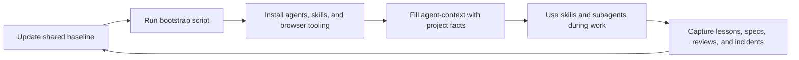
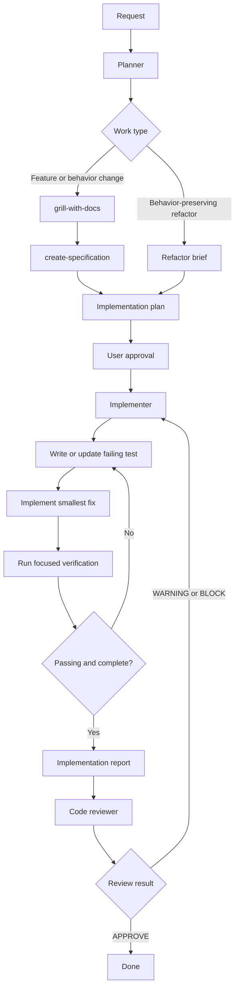
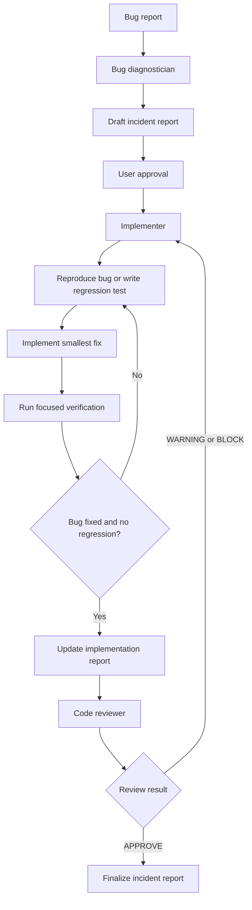

# coding-agent-baseline

This repository is the shared base I want to reuse across all of my projects.

It contains the general agent guidance that should apply everywhere, regardless of stack, folder structure, or project type. The goal is to keep one central set of broad rules and standards that I can reference from each individual project.

The shared baseline stays in `AGENTS.md` and `CLAUDE.md`. This repo bootstraps both files into each project as exact copies of the shared defaults.

Reusable coding, design, refactoring, debugging, and review guidance lives in the installable `engineering-standards` skill. Testing guidance lives in the installable `testing-standards` skill. REST API contract guidance lives in the installable `rest-api-design` skill. Requirements review against project documentation lives in the customized `grill-with-docs` skill. Structured project-context discovery lives in the customized `codebase-onboarding` skill. Each project should keep its shared project-specific context in `agent-context/`, such as:

- folder structure
- tech stack
- architecture conventions
- testing expectations
- project-specific workflows

Each project can also keep private local notes in:

- `AGENTS.local.md`
- `CLAUDE.local.md`

Those local files are ignored by git and are meant for local-only notes.

In other words:

- this repo defines the default baseline
- each project documents shared project-specific context in `agent-context/`
- this repo stores baseline skill overrides in `skills/skill-overrides/`
- each project receives installed-skill overrides in `.agents/skill-overrides/`
- each machine can keep private notes in the local files

This setup keeps the global guidance consistent while still allowing every project to document what makes it unique.

## Workflows

The baseline is organized around a few repeatable workflows that keep context, planning, implementation, and review connected across agents and tools. The same flow works whether the work happens in Codex, Claude Code, or a mix of both, because the durable handoff artifacts live in the project repo.

### Project Setup Cycle



### Feature Or Refactor Workflow



### Bug Workflow



Workflow artifacts are intentionally split by durability:

- `agent-context/` keeps shared project facts that should shape future work
- `docs/spec/` keeps approved feature specifications
- `docs/incidents/` keeps durable bug investigations and final incident reports
- `.agents/implementation-plans/`, `.agents/implementation-reports/`, and `.agents/code-reviews/` keep local coordination notes and review passes
- `.agents/lessons/LESSONS.md` keeps reusable lessons learned from previous work

## Skill Overrides

Installed skills (including marketplace skills) are overwritten when they update, so editing a skill directly to change its behavior for one project does not survive. This baseline keeps shared override sources in [skills/skill-overrides](skills/skill-overrides), and the bootstrap copies them into each target repo's `.agents/skill-overrides/` directory:

- one file per overridden skill, named `<skill-name>.md` to match the skill's name
- `skills/skill-overrides/INDEX.md` lists each baseline override with a one-line summary
- target repos consume those overrides from `.agents/skill-overrides/INDEX.md`

The baseline rule in `AGENTS.md` tells agents to check `INDEX.md` before running a skill and, when the skill is listed, to read and apply the matching `<skill-name>.md` override as taking precedence over the skill's default behavior. This works for both Claude Code and Codex because both read `AGENTS.md`.

Overrides are for adjusting guidance the agent should follow (for example, where a skill saves its output or how strictly a workflow should run). They are shared with the team, unlike the private `AGENTS.local.md` / `CLAUDE.local.md` files.

## Initialize A New Project

Run the bootstrap script from this repo and point it at the target project repo:

```bash
python scripts/init_project_agent.py ../your-project-repo
```

The script will:

- copy this repo's `AGENTS.md` into the target repo
- copy this repo's `CLAUDE.md` into the target repo
- create `AGENTS.local.md` and `CLAUDE.local.md` when they do not already exist
- add the local files to the target repo's `.gitignore`
- add project-local task note folders to the target repo's `.gitignore`
- copy missing shared subagent files from this repo's `agents/`
- install missing Claude Code subagent files into `.claude/agents/`
- install missing Codex custom agent files into `.codex/agents/`
- create `agent-context/` in the target repo
- copy missing baseline project-context starter files from this repo's `agent-context/`
- create `agent-context/README.md` when it does not already exist
- create `docs/incidents/README.md` when it does not already exist
- create `.agents/lessons/LESSONS.md` when it does not already exist
- copy baseline skill overrides from `skills/skill-overrides/` into `.agents/skill-overrides/`
- add `.agents/code-reviews/`, `.agents/refactor-briefs/`, `.agents/implementation-plans/`, and `.agents/implementation-reports/` to the target repo's `.gitignore` for shared local handoff reports
- add `.agents/tasks/`, `.codex/tasks/`, and `.claude/tasks/` to the target repo's `.gitignore` for local task notes
- copy every installable skill from this repo's `skills/` folder into the target repo's `.agents/skills/` and `.claude/skills/`
- install or refresh upstream skills with `npx skills add`
- copy missing Playwright CLI baseline files from `.playwright/`
- install `@playwright/cli` as a dev dependency
- install `agent-browser` as a dev dependency and run `agent-browser install`
- add Playwright CLI generated-artifact paths to the target repo's `.gitignore`
- write `agent-context/skills-installed.json` so the setup can be rerun cleanly
- write `skills-lock.json` for upstream skill installs

## Playwright CLI Baseline

The bootstrap copies `.playwright/cli.config.json` and `.playwright/README.md` into each target project when those files are missing.

The bootstrap installs Playwright CLI as a dev dependency using the package manager implied by `packageManager` or the existing lockfile. When no `package.json` or lockfile exists, it defaults to npm, which creates the package metadata during installation.

The equivalent manual npm command is:

```bash
npm install --save-dev @playwright/cli@latest
```

Use the project-local command:

```bash
npx playwright-cli --help
npx playwright-cli config-print
npx playwright-cli open http://localhost:3000 --headed
```

The CLI automatically loads `.playwright/cli.config.json` when present. Generated snapshots and output are ignored by the bootstrap-managed `.gitignore` entries.

## Agent Browser Baseline

The bootstrap installs Agent Browser as a dev dependency using the package manager implied by `packageManager` or the existing lockfile. It then runs the package manager's local executable command for:

```bash
agent-browser install
```

The equivalent manual npm commands are:

```bash
npm install --save-dev agent-browser@latest
npx agent-browser install
```

The bootstrap also installs the upstream `agent-browser` skill so agents know how to use the local browser automation tool.

## Upstream Skills

The bootstrap installs or refreshes these upstream skills on every run:

| Skill | Source | Purpose |
| --- | --- | --- |
| `find-skills` | `vercel-labs/skills` | Search the skills ecosystem and install useful skills. |
| `agent-browser` | `vercel-labs/agent-browser` | Use persistent browser automation across agent commands. |
| `handoff` | `mattpocock/skills` | Create concise handoff documents for continuing work across sessions or agents. |
| `improve-codebase-architecture` | `mattpocock/skills` | Identify architecture improvements in an existing codebase. |
| `tdd` | `mattpocock/skills` | Guide behavior-focused test-driven development with red-green-refactor cycles. |
| `changelog-automation` | `wshobson/agents` | Generate or maintain changelog entries from project changes. |
| `stop-slop` | `hardikpandya/stop-slop` | Remove predictable AI writing patterns from prose. |
| `create-readme` | `github/awesome-copilot` | Create a concise, useful project README. |
| `create-specification` | `github/awesome-copilot` | Create durable AI-ready specifications before implementation. |
| `prd` | `github/awesome-copilot` | Generate Product Requirements Documents from business vision and feature requirements. |
| `refactor` | `github/awesome-copilot` | Refactor code safely without changing behavior. |
| `sql-code-review` | `github/awesome-copilot` | Review SQL for correctness, security, maintainability, and performance. |
| `sql-optimization` | `github/awesome-copilot` | Optimize SQL queries, indexes, and execution patterns. |
| `update-specification` | `github/awesome-copilot` | Keep existing specifications aligned with new requirements and code changes. |

The equivalent manual commands are:

```bash
npx skills add https://github.com/vercel-labs/skills --skill find-skills --agent codex claude-code --copy -y
npx skills add https://github.com/vercel-labs/agent-browser --skill agent-browser --agent codex claude-code --copy -y
npx skills add https://github.com/mattpocock/skills --skill handoff improve-codebase-architecture tdd --agent codex claude-code --copy -y
npx skills add https://github.com/wshobson/agents --skill changelog-automation --agent codex claude-code --copy -y
npx skills add https://github.com/hardikpandya/stop-slop --skill stop-slop --agent codex claude-code --copy -y
npx skills add https://github.com/github/awesome-copilot --skill create-readme create-specification prd refactor sql-code-review sql-optimization update-specification --agent codex claude-code --copy -y
```

`grill-with-docs` is installed from this repo's [skills/grill-with-docs](skills/grill-with-docs) instead of upstream so it can use `agent-context/` as the documentation source and treat `agent-context/domain.md` as the local replacement for upstream `CONTEXT.md`.

`codebase-onboarding` is installed from this repo's [skills/codebase-onboarding](skills/codebase-onboarding) instead of upstream so it fills `agent-context/` with structured, evidence-backed project documentation.

## Shared Subagents

Shared subagent source files live in [agents](agents). The bootstrap copies missing files from this folder into each target repo's `agents/` directory without overwriting project-local versions. It also installs missing Claude Code subagents under `.claude/agents/*.md` and missing Codex custom agents under `.codex/agents/*.toml`.

The planning subagent in [agents/planner.md](agents/planner.md) adapts the upstream planner pattern to this repo's requirements workflow: `grill-with-docs` first, then either `create-specification` for feature work or a behavior-preserving refactor brief for refactor work. It saves specifications under `docs/spec/`, refactor briefs under `.agents/refactor-briefs/`, and implementation plans under `.agents/implementation-plans/`.

The bug diagnosis subagent in [agents/bug-diagnostician.md](agents/bug-diagnostician.md) investigates non-trivial, ambiguous, recurring, CI-related, production-like, cross-module, or user-facing bugs before implementation. It drafts the durable incident report under `docs/incidents/incident_YYYYMMDD_short_description.md`, capturing the evidence, root-cause hypothesis, fix direction, and verification plan in an Investigation section that `code-reviewer` trims to a summary when it finalizes the report after the fix. The draft incident report — investigation, proposed fix direction, and verification plan — must be shown to the user for approval before implementation starts.

Incident reports are durable project documents. Keep them under [docs/incidents](docs/incidents), not under `.agents/`, so they can be reviewed and retained with the project history.

The implementation subagent in [agents/implementer.md](agents/implementer.md) executes approved specifications, refactor briefs, and implementation plans, then routes into skills as needed, including `engineering-standards` for code work, `testing-standards` for tests, `refactor` for behavior-preserving structure changes, and `rest-api-design` for API changes. It creates or updates `.agents/implementation-reports/implementation_YYYYMMDD_feature_name.md` as the shared handoff artifact. When `code-reviewer` returns findings, the implementer fixes only those findings, reruns verification, updates the implementation report, and hands the updated touched file list back for another review pass.

The code review subagent in [agents/code-reviewer.md](agents/code-reviewer.md) reviews implementer-touched files against the planner specification or refactor brief and shared implementation report, applies `engineering-standards`, `testing-standards`, and `refactor` for refactor work, and routes database changes through `sql-code-review` and `sql-optimization` when relevant. It does not edit the code under review, returns `APPROVE`, `WARNING`, or `BLOCK` for the shared review-fix loop, and saves every review pass as `.agents/code-reviews/review_YYYYMMDD_feature_name_pass_N.md` so all agents can read the same report. For bug fixes it also finalizes the durable incident report under `docs/incidents/` from the implementer's confirmed facts on the `APPROVE` pass.

The Skills CLI writes the project lock file and installs Codex copies under `.agents/skills/<skill>` plus Claude Code copies under `.claude/skills/<skill>`. The bootstrap leaves those paths as-is and does not mirror Codex skills into `.codex/skills`.

Rerun the bootstrap to refresh upstream skills in a project.

To change which skills get installed into future projects, add or remove skill folders in [skills](skills).

Repo-only skills for maintaining this shared repo are kept in [.agents/skills](.agents/skills) for Codex and mirrored into [.claude/skills](.claude/skills) for Claude Code. Keep this local set intentionally small: `git-conventional-commit` and `initialize-project-agent`. Do not place repo-only skills in `skills/`, because everything installable there is copied into new project repos.

Why both skill folders:

- Codex looks for repo-local skills under `.agents/skills/`
- Claude Code looks for repo-local skills under `.claude/skills/`
- the shared `SKILL.md` format works for both, so this repo keeps the same repo-only skills in each tool's expected location

## Sync Updated Shared Skills

When you want to propagate an updated shared skill from `skills/`, sync that change into any maintained copies in this repo and sibling project repos under `../`:

```bash
python scripts/sync_skills.py
```

To sync only one shared skill:

```bash
python scripts/sync_skills.py git-conventional-commit
```

The sync script only updates matching `.agents/skills/<skill>/` and `.claude/skills/<skill>/` directories that already exist. It does not install missing shared skills into every sibling repo automatically.
