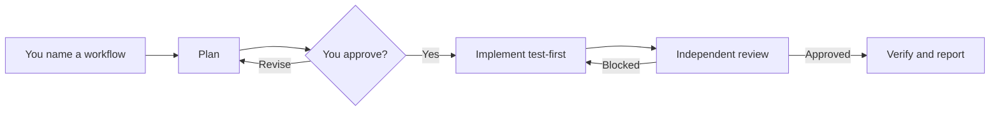

# Lean Coding Agent

**Engineering discipline for your coding agent, without the bloat.**

Coding agents do well on small requests and drift on large ones. The usual answer is a framework, but many are full of bloat: long instructions on every task, mandatory process for small requests, and extra tooling to learn.

Lean Coding Agent makes a different bet: ordinary requests stay ordinary. You get a rigorous plan, implement, review loop only when you ask for one, and a direct answer the rest of the time. It's a set of small, composable skills for Codex and Claude Code. The always-loaded baseline is under 800 words, and each workflow skill is under 450.

## See it in action

Ask for help as usual and the agent simply does the work. When a change deserves more rigor, name a workflow:

```text
/workflow-bug-fixing Checkout returns 500 when the cart is empty
```

1. A diagnostician investigates and records the root cause in an incident report.
2. You approve the repair plan. Nothing changes before that.
3. An implementer reproduces the bug in a test, then fixes it.
4. An independent reviewer checks the change, and the loop repeats until it's approved. If the same problem survives three fix attempts, the agent stops and reports back.



## Why it's built this way

- **Process is opt-in.** A workflow starts only when you name it. Both Codex and Claude Code are configured to stop the agent from starting one itself.
- **Workflows stay slim.** Each is a short list of orchestration steps. Detailed instructions live in four dedicated subagents (planner, diagnostician, implementer, and reviewer), leaving more room in the main session's context window.
- **The review loop is bounded.** After three failed fixes for the same problem, or if success would mean weakening a test or expanding scope, the agent stops and reports back instead of forcing a green result.
- **Each workflow fits its work.** Bug repairs need an approved diagnosis, refactors stop if behavior would change, and reviews don't edit code.
- **Task memory lives in files.** Plans, implementation reports, reviews, and incident reports outlast auto-compaction and the session.
- **Models follow the work.** By default, setup spends on judgment and saves on execution: stronger models plan and review, and faster models diagnose and implement. See [Model defaults](#model-defaults).
- **Skills adapt without forking.** [Skill overrides](#skill-overrides) add project guidance from a separate file, so installed skills can keep updating from upstream.

### The evidence for keeping context small

More agent instructions aren't automatically better:

- [Gloaguen et al.](https://arxiv.org/abs/2602.11988) found that context files do not generally improve task success rates, while increasing inference cost by over 20% on average. That held for both LLM-generated and developer-committed files.
- [Lulla et al.](https://arxiv.org/abs/2601.20404) found that developer-written `AGENTS.md` files were associated with lower median runtime and fewer output tokens, with comparable task completion.

So context earns its place through operational facts an agent can't discover on its own, not through overviews. [`AGENTS.md`](AGENTS.md) holds only the essential rules. Project conventions live in modular files under `docs/conventions/`, loaded on demand, and [`init-conventions`](skills/init-conventions/SKILL.md) runs commands before recording them. Read the [full rationale](docs/init-conventions-rationale.md), including the limits of this evidence.

## Is it for you?

**It's a good fit if** you use Codex or Claude Code on real codebases and want rigor for the changes that need it, without paying for it on every task.

**It's probably not a good fit if** you want a process enforced on every change, or you use a coding agent other than Codex or Claude Code.

## Quick start

You need Node.js, npm, and a project opened in Codex or Claude Code.

1. Install the skills from your project directory:

   ```sh
   npx skills@latest add aloilor/lean-coding-agent
   ```

   In the installer, select Codex, Claude Code, or both, then select `setup-lean-coding-agent` and any other skills you want.

2. Read [what setup changes](#what-setup-changes), especially if your project already has an `AGENTS.md` or `CLAUDE.md`.

3. Run setup in your project: `/setup-lean-coding-agent` in Claude Code, or `$setup-lean-coding-agent` in Codex.

   Setup asks which coding agents to configure and which model each subagent should use, then offers to capture your project's conventions.

4. Work as usual, or call a skill by name, such as `/workflow-feature-development` in Claude Code or `$workflow-feature-development` in Codex.

## What setup changes

> [!WARNING]
> Setup replaces `AGENTS.md` and `CLAUDE.md` on every run, so any existing content in them is lost. Before you run it, move shared project rules to `docs/conventions/` and private notes to `AGENTS.override.md`. Rerunning setup leaves those files alone.

| Change | Details |
| --- | --- |
| Replaced on every run | `AGENTS.md` and `CLAUDE.md`. `AGENTS.md` is the active baseline, and `CLAUDE.md` points Claude Code to it. |
| Refreshed on every run | The four bundled subagents in `.codex/agents/` or `.claude/agents/`, the bundled skill overrides, the upstream skills below, and the three bundled templates in `.agents/templates/`. Your own agents, templates, and override index entries are preserved. |
| Created when missing | `AGENTS.override.md`, `.agents/lessons/`, `.agents/skill-overrides/`, and, for Codex, `.codex/config.toml` with multi-agent defaults and a status line. |
| Added to `.gitignore` | Local files, agent task and report directories, and `node_modules/`. |
| Installed | `agent-browser@latest` as a development dependency, plus its browser runtime, and the [upstream skills](#upstream-skills-installed-by-setup) from third-party repositories. |

Setup uses your project's package manager and falls back to npm, so a project without a `package.json` gets one.

`docs/conventions/` is written by [`init-conventions`](skills/init-conventions/SKILL.md), not by setup. Incident reports in `docs/incidents/` can be committed. Plans, implementation reports, and code reviews are git-ignored by default.

## Skills

### Setup and project context

- [`setup-lean-coding-agent`](skills/setup-lean-coding-agent/SKILL.md) — install the baseline into the current project.
- [`init-conventions`](skills/init-conventions/SKILL.md) — initialize or refresh `docs/conventions/` with repo-specific, verified commands, examples to follow, boundaries, and traps.
- [`lean-grill-with-docs`](skills/lean-grill-with-docs/SKILL.md) — clarify plans against project terminology and documented decisions. Forked and adapted from [Matt Pocock's original skill](https://github.com/mattpocock/skills).
- [`feature-specification`](skills/feature-specification/SKILL.md) — write a client-approvable feature spec from a fixed template.

### Change workflows

Workflows are user-invoked only: name one in your request to start it. The Claude Code skills set `disable-model-invocation: true`, and the Codex skills set `policy.allow_implicit_invocation: false` in `agents/openai.yaml`.

| Workflow | Use it for | Process | Guide |
| --- | --- | --- | --- |
| [`workflow-planning`](skills/workflow-planning/SKILL.md) | Planning work without implementing it. | Resolve scope, decisions, acceptance criteria, and verification expectations, then approve the plan. | [Planning](docs/workflows/planning.md) |
| [`workflow-feature-development`](skills/workflow-feature-development/SKILL.md) | Changing externally observable behavior. | Approve a plan, implement test-first, then review and verify. | [Feature development](docs/workflows/feature-development.md) |
| [`workflow-bug-fixing`](skills/workflow-bug-fixing/SKILL.md) | Investigating and repairing a bug or regression. | Diagnose, approve the repair plan, fix test-first, then review and verify. | [Bug fixing](docs/workflows/bug-fixing.md) |
| [`workflow-refactor`](skills/workflow-refactor/SKILL.md) | Restructuring code while preserving behavior. | Establish a baseline, approve a plan, make small changes, then review and verify. Stops if behavior would change. | [Refactoring](docs/workflows/refactor.md) |
| [`workflow-review`](skills/workflow-review/SKILL.md) | Reviewing code or assessing risk. | Record findings in severity order. Makes no fixes unless you ask. | [Code review](docs/workflows/review.md) |

The [workflow guides](docs/workflows/README.md) include process diagrams. The linked skills remain the canonical instructions.

Each workflow leaves a written record of the agreed scope, decisions, and verification evidence:

| Record | Path |
| --- | --- |
| Approved plan | `.agents/plans/plan_YYYYMMDD_<name>.md` |
| Implementation report | `.agents/implementation-reports/implementation_YYYYMMDD_<name>.md` |
| Review pass | `.agents/code-reviews/review_YYYYMMDD_<name>_pass_N.md` |
| Incident report | `docs/incidents/incident_YYYYMMDD_<name>.md` |

Setup installs shared [plan](skills/setup-lean-coding-agent/references/templates/plan.md), [implementation-report](skills/setup-lean-coding-agent/references/templates/implementation-report.md), and [code-review](skills/setup-lean-coding-agent/references/templates/code-review.md) templates, used by the planners, implementers, and reviewers of both coding agents.

### Engineering and Git

- [`git-conventional-commit`](skills/git-conventional-commit/SKILL.md) — create Conventional Commits when asked to commit, and push when asked.
- [`maintain-changelog`](skills/maintain-changelog/SKILL.md) — inspect Git history in any commit format and curate released or unreleased changes using Keep a Changelog and Semantic Versioning.

### Upstream skills installed by setup

| Skill | Source | Use when |
| --- | --- | --- |
| [`agent-browser`](https://github.com/vercel-labs/agent-browser/blob/main/skills/agent-browser/SKILL.md) | [vercel-labs/agent-browser](https://github.com/vercel-labs/agent-browser) | Navigate and interact with websites, fill forms, extract page data, or test web apps through a browser. |
| [`eli5`](https://www.skills.sh/anthropics/claude-plugins-community/eli5) | [anthropics/claude-plugins-community](https://github.com/anthropics/claude-plugins-community) | Explain a topic in beginner-friendly terms using a visual HTML artifact. |
| [`handoff`](https://github.com/mattpocock/skills/blob/main/skills/productivity/handoff/SKILL.md) | [mattpocock/skills](https://github.com/mattpocock/skills) | Pass ongoing work to another agent or session with a concise summary, next steps, and links to existing artifacts. |
| [`tdd`](https://github.com/mattpocock/skills/blob/main/skills/engineering/tdd/SKILL.md) | [mattpocock/skills](https://github.com/mattpocock/skills) | Build a feature or fix a bug test-first, one behavior slice at a time, using red-green-refactor. |
| [`refactor`](https://github.com/github/awesome-copilot/blob/main/skills/refactor/SKILL.md) | [github/awesome-copilot](https://github.com/github/awesome-copilot) | Improve code structure or readability while preserving externally visible behavior. |
| [`skill-creator`](https://github.com/anthropics/skills/tree/main/skills/skill-creator) | [anthropics/skills](https://github.com/anthropics/skills) | Create, improve, and evaluate agent skills with structured test cases and benchmarks. |

## Configuration

### Model defaults

The defaults spend on judgment and save on execution. You can choose a different model for each subagent during setup, or pass options such as `--planner-model` for Codex and `--claude-planner-model` for Claude Code.

| Subagent | Role | Codex | Claude Code |
| --- | --- | --- | --- |
| `planner` | Prepares plans. | `gpt-6.1-sol`, `low` | `opus`, `low` |
| `code-reviewer` | Independently reviews changes. | `gpt-6.1-sol`, `low` | `opus`, `low` |
| `bug-diagnostician` | Investigates bugs. | `gpt-6-luna`, `max` | `haiku`, `xhigh` |
| `implementer` | Carries out approved plans. | `gpt-6-luna`, `xhigh` | `haiku`, `xhigh` |

Each entry shows the model and its reasoning effort.

### Skill overrides

Overrides add project guidance to an installed skill without changing the skill itself. Setup copies bundled overrides into `.agents/skill-overrides/` and maintains an `INDEX.md` there that maps skill names to their override files. Before using a skill, the agent checks this index and reads the matching `<skill-name>.md` file. If an override conflicts with the skill, the override takes precedence.

For example, the bundled [`tdd` override](skills/setup-lean-coding-agent/references/skill-overrides/tdd.md) applies the baseline's testing guidance whenever tests are planned, written, or reviewed. To add your own, create a matching Markdown file in `.agents/skill-overrides/` and link it from `INDEX.md`. Setup refreshes bundled override files while preserving your index entries.

To keep `lean-grill-with-docs` documentation somewhere other than the default `docs/conventions/GLOSSARY.md` and `docs/conventions/adr/`, choose a folder during setup (`--docs-dir docs/domain`). Setup generates the matching override for you.

## Updating

Update project-installed skills from the project directory:

```sh
npx skills update -p
```

Run `npx skills check` to see whether updates are available. To add skills introduced since your last selection, rerun `npx skills@latest add aloilor/lean-coding-agent` and select them. Rerun setup when you want refreshed project guidance, templates, overrides, or agent configuration. Remember that this replaces `AGENTS.md` and `CLAUDE.md`.

The Skills CLI owns skill installation, tracking, updates, and removal. See its [update documentation](https://github.com/vercel-labs/skills#skills-update) for scope options.

## Uninstalling

There's no uninstall command. To remove Lean Coding Agent from a project:

1. Run `npx skills remove` to remove the installed skills.
2. Remove the `agent-browser` development dependency.
3. Delete the [files setup created](#what-setup-changes) and its `.gitignore` entries.

## Project status

Releases follow [Semantic Versioning](https://semver.org/), so breaking changes land only in major versions. See the [changelog](CHANGELOG.md).

The automated tests cover setup, not how agents behave once they're using the skills. The evaluation of `init-conventions` so far is limited to two runs on this repository. Its [rationale](docs/init-conventions-rationale.md#limits-of-the-evidence) describes what hasn't been tested yet.

## Contributing

See [CONTRIBUTING.md](CONTRIBUTING.md).

## License

Available under the [MIT License](LICENSE).
