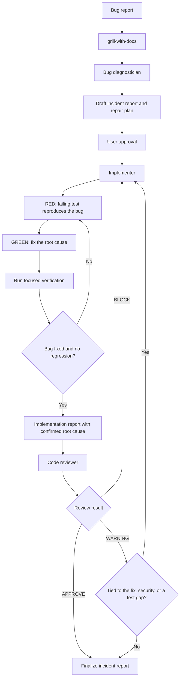

# Bug-Fixing Workflow

Use this workflow for bugs, regressions, failing tests, CI failures, and runtime errors. It investigates the cause before repair and records the incident, approved repair plan, test-first implementation, and independent review.

## Process

1. Run `grill-with-docs` before diagnosing or planning. Inspect relevant code, callers, tests, project context, and documentation.
2. Have the bug diagnostician investigate and draft `docs/incidents/incident_YYYYMMDD_<name>.md`. The main agent uses the evidence to write a plan at `.agents/plans/plan_YYYYMMDD_<name>.md`.
3. Present the symptom, evidence or likely cause, impact, proposed repair, and verification plan. Get explicit approval before changing production or test code.
4. After approval, have the implementer reproduce the failure and fix the root cause test-first. Record evidence in `.agents/implementation-reports/implementation_YYYYMMDD_<name>.md`.
5. Have the code reviewer review the repair and regression coverage. On approval, the reviewer finalizes the incident report with confirmed findings. Resolve concrete `BLOCK` findings and repeat review as needed. Treat `WARNING` findings as actionable when they identify a repair-plan issue, likely bug, security or privacy risk, or meaningful test gap.
6. The main agent runs relevant broader checks and closes out the repair. If it expands into feature behavior or contract work, stop and ask for user direction.

## Artifacts

- Incident report: `docs/incidents/incident_YYYYMMDD_<name>.md`
- Approved plan: `.agents/plans/plan_YYYYMMDD_<name>.md`
- Implementation report: `.agents/implementation-reports/implementation_YYYYMMDD_<name>.md`
- Review pass: `.agents/code-reviews/review_YYYYMMDD_<name>_pass_N.md`

## Flow

Canonical instructions: [workflow-bug-fixing](../../skills/workflow-bug-fixing/SKILL.md).
