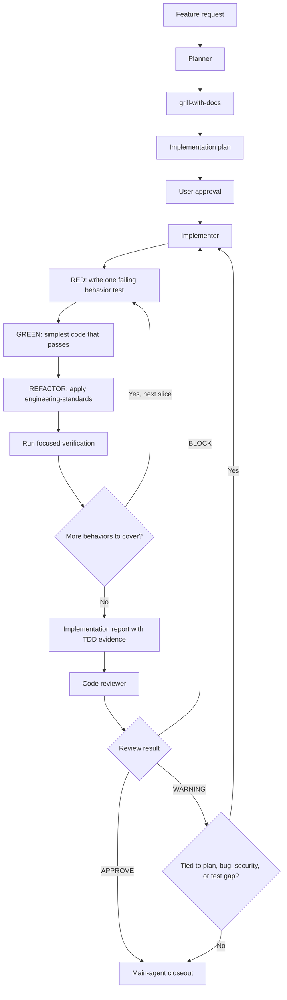

# Feature Development Workflow

Use this workflow for a feature or behavior change, from a small change through a cross-cutting feature. It establishes an approved plan, test-first implementation, independent review, and main-agent verification.

## Process

1. Run `grill-with-docs`, inspect the relevant code and documentation, then write a plan at `.agents/plans/plan_YYYYMMDD_<name>.md`. Get explicit user approval before implementation.
2. After approval, have the implementer work test-first through RED, GREEN, and REFACTOR. Record implementation and verification evidence in `.agents/implementation-reports/implementation_YYYYMMDD_<name>.md`.
3. Have the code reviewer assess the change independently and record each pass at `.agents/code-reviews/review_YYYYMMDD_<name>_pass_N.md`.
4. Resolve concrete `BLOCK` findings with the implementer and repeat focused checks and review. Address `WARNING` findings when they identify a plan issue, likely bug, security or privacy risk, or meaningful test gap.
5. The main agent runs relevant closeout verification, inspects the final diff, and reports behavior, verification, and residual risks.

## Artifacts

- Approved plan: `.agents/plans/plan_YYYYMMDD_<name>.md`
- Implementation report: `.agents/implementation-reports/implementation_YYYYMMDD_<name>.md`
- One or more review passes: `.agents/code-reviews/review_YYYYMMDD_<name>_pass_N.md`

## Flow

Canonical instructions: [workflow-feature-development](../../skills/workflow-feature-development/SKILL.md).
