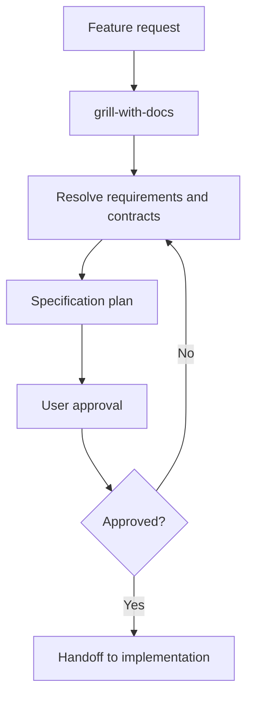

# Feature Specification Workflow

Use this workflow when the requirements, acceptance criteria, or contracts for a feature need to be settled before implementation. Its output is an approved specification plan; implementation is a separate workflow.

## Process

1. Run `grill-with-docs` before consolidating requirements or drafting the plan.
2. Resolve requirements, contracts, acceptance criteria, non-goals, decisions, risks, and verification expectations with the user.
3. Save the plan as `.agents/plans/plan_YYYYMMDD_<name>.md` and obtain explicit user approval.
4. Hand the approved plan to a later implementation task. Do not implement the feature in this workflow.

## Artifact

The approved specification plan is the durable handoff for implementation. Include implementation details only when the user requests them, an ADR requires them, or the existing architecture makes them necessary.

## Flow

Canonical instructions: [workflow-feature-specification](../../skills/workflow-feature-specification/SKILL.md).
