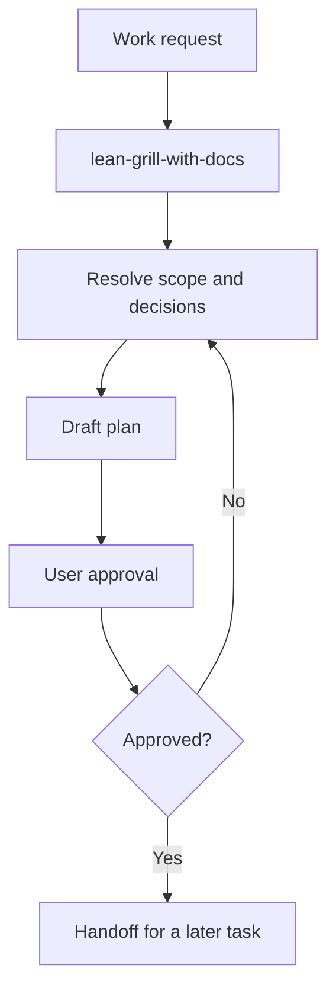

# Planning Workflow

Use this workflow when work should be explored and documented before implementation. It can cover a feature, bug fix, refactor, or another scoped change. Its output is an approved plan for a later task.

## Process

1. Run `lean-grill-with-docs` and inspect relevant project context.
2. Resolve material questions with the user; define scope, decisions, non-goals, acceptance criteria, risks, and verification expectations.
3. Save the draft to `.agents/plans/plan_YYYYMMDD_<name>.md` and obtain the user's approval.
4. Hand off the approved plan for a later task. Do not implement the work or start an implementation review in this workflow.

## Artifact

The approved `.agents/plans/plan_YYYYMMDD_<name>.md` is the durable handoff. Include the decisions, boundaries, acceptance criteria, implementation approach, risks, and verification expectations relevant to the request.

## Flow

Canonical instructions: [workflow-planning](../../skills/workflow-planning/SKILL.md).
