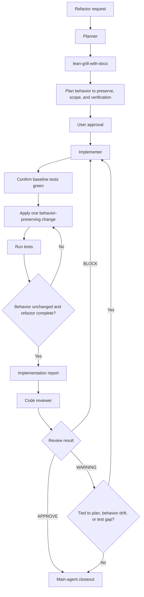

# Refactoring Workflow

Use this workflow to restructure code while preserving its behavior and contracts. It establishes a baseline, makes small changes while focused checks stay green, and uses an independent review to catch behavior drift.

## Process

1. Run `lean-grill-with-docs`, inspect the code area, callers, tests, and project documentation, then plan the preserved behavior, scope, risks, documentation impact, and verification.
2. Save the plan as `.agents/plans/plan_YYYYMMDD_<name>.md` and get explicit user approval before implementation. If inspection reveals a behavior change, stop and ask for direction.
3. After approval, establish focused test baselines and add characterization tests when needed. Have the implementer make one small behavior-preserving change at a time, rerunning focused tests after meaningful steps.
4. Record evidence in `.agents/implementation-reports/implementation_YYYYMMDD_<name>.md`. Have the code reviewer check for behavior drift, scope creep, missed tests, unnecessary abstraction, and stale documentation; record each pass under `.agents/code-reviews/review_YYYYMMDD_<name>_pass_N.md`.
5. Resolve concrete `BLOCK` findings and repeat focused checks and review. Treat warnings tied to the plan, behavior drift, or a meaningful test gap as actionable. The main agent runs final verification and closes out the refactor.

## Artifacts

- Approved plan: `.agents/plans/plan_YYYYMMDD_<name>.md`
- Implementation report: `.agents/implementation-reports/implementation_YYYYMMDD_<name>.md`
- One or more review passes: `.agents/code-reviews/review_YYYYMMDD_<name>_pass_N.md`

## Flow

Canonical instructions: [workflow-refactor](../../skills/workflow-refactor/SKILL.md).
