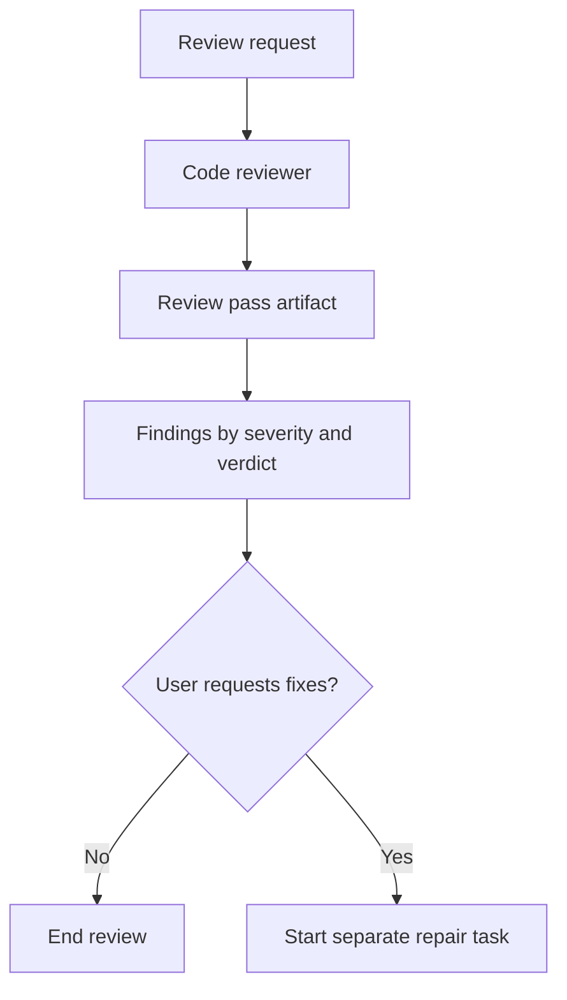

# Code Review Workflow

Use this workflow for a requested code review, audit, or risk assessment. It is review-only: the reviewer records findings and a verdict without editing code or starting a repair.

## Process

1. Spawn the code reviewer to review the requested scope.
2. Record the review pass at `.agents/code-reviews/review_YYYYMMDD_<name>_pass_N.md`.
3. Report findings first, ordered by severity, with file and line references when available. State the verdict, review coverage, residual risks, and omissions.
4. Do not edit code, run an implementer, or enter a fix loop unless the user explicitly asks for fixes.

## Artifact

Each review run produces a durable pass artifact under `.agents/code-reviews/`.

## Flow

This workflow does not run `grill-with-docs` or create a plan. Canonical instructions: [workflow-review](../../skills/workflow-review/SKILL.md).
